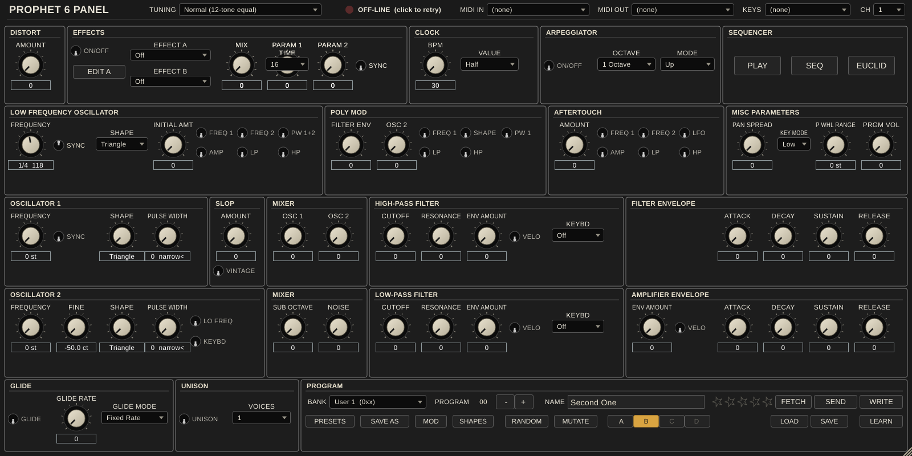

# Prophet 6 Panel

A controller panel for the Sequential Prophet-6, as an Audio Unit, VST3 and standalone app for macOS.
It puts every sound parameter of the synth on one screen inside your DAW and talks to the synth over MIDI.



This is a personal tool. I built it for my own Prophet-6 and my own way of working, with the help of
Anthropic's Claude, and I am sharing the source in case it is useful to someone else.
**It is offered as is, with no support and no guarantee that it works on your setup.**

It is not made, endorsed or supported by Sequential. "Prophet-6" and "Sequential" are trademarks of
their owner and are used here only to say which instrument the panel is for.

## What it does

- **Front panel:** all program parameters as knobs, switches and menus. Changes go to the synth as NRPNs;
  FETCH reads the synth's edit buffer back into the panel.
- **Preset browser:** the factory and user banks by category, with search, star ratings and your own
  one-line note per sound. A library keeps any number of sounds as files on disk.
- **A B C D:** four sounds side by side for comparing. Each letter remembers where its sound came from.
- **LFO sync display:** with SYNC on, the FREQUENCY knob shows the note value it selects (see below).
- **MOD page:** extra LFOs, a step sequencer, an envelope and an X/Y pad that modulate the synth's
  parameters over MIDI.
- **SEQ page:** an editor for the synth's own polyphonic sequence.
- **EUCLID page:** four Euclidean tracks that play the synth in time with the host. Off by default.
- **RANDOM and MUTATE** for sound design, and alternative tunings.

Nothing is ever written to the synth's stored programs unless you press WRITE or SAVE AS yourself.

## LFO sync: what the FREQUENCY knob selects

Sequential's manual does not say which note values the LFO FREQUENCY knob selects when LFO SYNC is on.
This table was measured on a Prophet-6 (a MIDI sweep of the knob, one value per bar, recorded and analysed).
The knob's 0-254 range is 18 steps of 14 values each; one LFO cycle lasts the note value shown.

| Knob value | LFO cycle | Knob value | LFO cycle |
|---|---|---|---|
| 0-13 | longer than 4 bars (not measured) | 126-139 | 1/4 triplet |
| 14-27 | 4 bars | 140-153 | 1/8 dotted |
| 28-41 | 2 bars | 154-167 | 1/8 |
| 42-55 | 1.5 bars | 168-181 | 1/8 triplet |
| 56-69 | 1 bar | 182-195 | 1/16 dotted |
| 70-83 | 1/2 dotted | 196-209 | 1/16 |
| 84-97 | 1/2 | 210-223 | 1/16 triplet |
| 98-111 | 1/4 dotted | 224-237 | 1/32 |
| 112-125 | 1/4 | 238-254 | 1/32 triplet |

The 1/4 step was checked separately: a square LFO on the amplifier pulses once per beat.

## What you need

- A Mac with Apple Silicon, macOS 11 or later
- Xcode's command line tools and CMake 3.22 or later
- A Prophet-6 (keyboard or module) connected by USB or MIDI, set to send and receive NRPN and SysEx

The build fetches the JUCE framework (version 8.0.9) by itself the first time.

## Building

```bash
cmake -B build -DCMAKE_BUILD_TYPE=Release
cmake --build build --config Release -j8
```

The build copies the Audio Unit and the VST3 into your user plug-in folders
(`~/Library/Audio/Plug-Ins`). The standalone app is in `build/P6Panel_artefacts`.

To build and run the tests as well, configure with `-DP6V2_BUILD_TEST=ON`.

## Using it

1. Insert "Prophet 6 Panel" as an audio effect on the channel your Prophet-6 plays through
   (it passes audio through unchanged), or start the standalone app.
2. Choose the synth's ports under MIDI IN and MIDI OUT. The panel shows ON-LINE when the synth answers.
3. Press FETCH to read the current sound from the synth.

The panel keeps its own files (ratings, notes, the sound library) in
`~/Documents/Claude Plugins Data/Prophet 6 Patches`.

## Good to know

- It has only been used on one setup: macOS with Logic Pro and a Prophet-6 module. Other hosts are untested.
- In the plug-in menu it appears under the maker name "Claude", after the AI assistant it was written with.
  It is not an Anthropic product.
- The panel is built on [JUCE](https://juce.com), used under its open-source licence, so this project
  is shared under the GNU AGPL v3.
